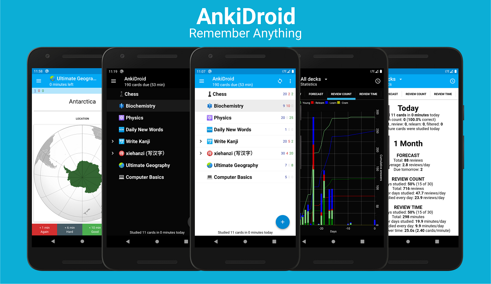

# AnkiDroid 火热连胜 · Study Streak

这是基于 **AnkiDroid v2.25.3** 的个人修改版。完整源码保留在本仓库，增加完成每日计划才计入的连胜、7 天庆祝、真实完成 30 天奖励补签卡，以及原子化的连续多日补签。

- [使用、安装与构建说明](STUDY_STREAK.md)
- [架构与规则](docs/study-streak.md)
- [测试结果](docs/study-streak-validation.json)：新增 46 项测试通过；相关既有测试 58 项通过、2 项原有跳过；Android lint 0 错误、0 警告。
- [可应用于官方 v2.25.3 的补丁](patches/AnkiDroid-study-streak.patch)
- [下载 Debug APK](https://github.com/Water5tar/ankidroid-study-streak/releases)

Debug 版使用独立包名 `com.ichi2.anki.debug`，与正式版分开保存设置。请保留原版，通过导出／导入整个集合迁移卡片与进度；手势、主题等 Android 应用设置需另行配置。尚未进行真机运行、实际音效播放或实时 AnkiWeb 同步验证。

本项目由 OpenAI Codex（GPT-6.1-sol）辅助实现，未向上游提交 PR。它不是官方发布版；官方项目的许可证、贡献规范与署名均保留。下面为上游 README。

---

<p align="center">

</p>

<a href="https://github.com/ankidroid/Anki-Android/releases"></a>
<a href="https://github.com/ankidroid/Anki-Android/actions"></a>
<a href="https://opencollective.com/ankidroid"></a>
<a href="https://github.com/ankidroid/Anki-Android/issues"></a>
<a href="https://github.com/ankidroid/Anki-Android/network/members"></a>
<a href="https://github.com/ankidroid/Anki-Android/stargazers"></a>
<a href="https://crowdin.com/project/ankidroid"></img></a>
<a href="https://github.com/ankidroid/Anki-Android/graphs/contributors"></a>
<a href="https://discord.gg/qjzcRTx"></img></a>
<a href="https://github.com/ankidroid/Anki-Android/blob/main/COPYING"></a>

# AnkiDroid
A semi-official port of the open source [Anki](https://apps.ankiweb.net/index.html) spaced repetition flashcard system to Android. Memorize anything with AnkiDroid!

</img>

### Features

<div style="display:flex;">
 
- Night mode
- Whiteboard 
- Progress widget
- Detailed statistics
- Syncing with AnkiWeb
- Write answers (optional)
- Text-to-speech integration
- More than 10,000 premade decks
- Spaced repetition (AI-optimized [FSRS algorithm](https://github.com/open-spaced-repetition))
- Supported contents: text, images, sounds, MathJax
- Add cards by intent from other applications like dictionaries

</div>

Install
---------
<div style="display:flex;">

<a href="https://play.google.com/store/apps/details?id=com.ichi2.anki&utm_source=global_co&utm_medium=prtnr&utm_content=Mar2515&utm_campaign=PartBadge&pcampaignid=MKT-Other-global-all-co-prtnr-py-PartBadge-Mar2515-1">
    </a>

<a href="https://f-droid.org/repository/browse/?fdid=com.ichi2.anki">
    </a>

<a href="http://apps.obtainium.imranr.dev/redirect.html?r=obtainium://add/https://github.com/ankidroid/Anki-Android">
    </a>

</div>

Signing certificate fingerprint to [verify](https://developer.android.com/studio/command-line/apksigner#usage-verify) the APK:
```
SHA-256: 2071534f0f4b5e54ae952dd275d70da6e3459ee69909d2ab1b4843c4c5b21a45 
SHA-1: f24e06a3657b190a12671100402df32d7b9b3d36
```

Wiki
----
View [Wiki](https://github.com/ankidroid/Anki-Android/wiki)

Help
----
Check the [user manual](https://docs.ankidroid.org/) and the wiki for usage instructions. See the [help page](https://docs.ankidroid.org/help.html) 
for how to submit a bug report or contact a project member, etc.

Contribute
----------
You can contribute to AnkiDroid by beta testing, translating, or submitting code. 
See the [contribution wiki page](https://github.com/ankidroid/Anki-Android/wiki/Contributing) for more info.

Join Us On
----------

<a href="https://discord.gg/qjzcRTx"></a>
<a href="https://www.reddit.com/r/Anki"></a>
<a href="https://www.facebook.com/AnkiDroid/"></a>
<a href="https://x.com/ankidroid"></a>
<a href="https://forums.ankiweb.net/"></a>

## Credits
<!--- Do not rename this section. AnkiDroid contains a deep link to the section
header - see https://github.com/ankidroid/Anki-Android/pull/11803 --->

### Code Contributors

Thanks to these awesome code contributors who keep this project going

<a href="https://github.com/ankidroid/Anki-Android/graphs/contributors"></a>

### [Sponsors](https://opencollective.com/ankidroid#sponsor)
<a href="https://opencollective.com/ankidroid#sponsor" target="_blank">
  
</a>

### [Backers](https://opencollective.com/ankidroid#backer)

A big thank you to each of our backers 🙏
<a href="https://opencollective.com/Ankidroid#backers" target="_blank"></a>

<p>Your generous donations mean the world to us, and we can't express our gratitude enough. Your support fuels our mission and helps us make a real difference</p>

<a href="https://opencollective.com/Ankidroid/donate" target="_blank">
  
</a>

### [Translators](https://crowdin.com/project/ankidroid/activity-stream)

Thanks to our 1400 translators, for allowing us to be available, partially or totally, in 99 languages as of July 2022.

License
-------
* [GPL-3.0 License](https://github.com/ankidroid/Anki-Android/blob/main/COPYING)
* [AGPL-3.0 License](https://github.com/ankitects/anki/blob/main/LICENSE) for some part of the back-end
* [LGPL-3.0 License](https://github.com/ankidroid/Anki-Android/blob/main/api/COPYING.LESSER) for the AnkiDroid API
